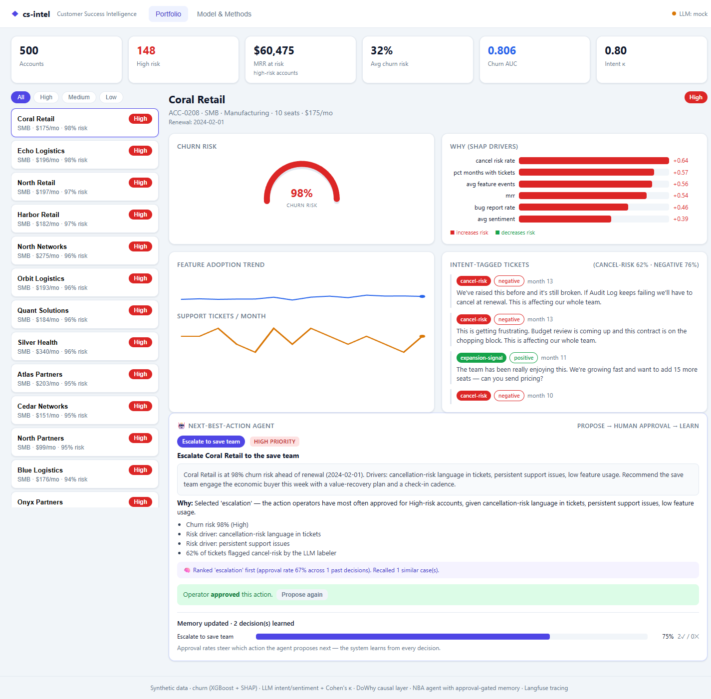
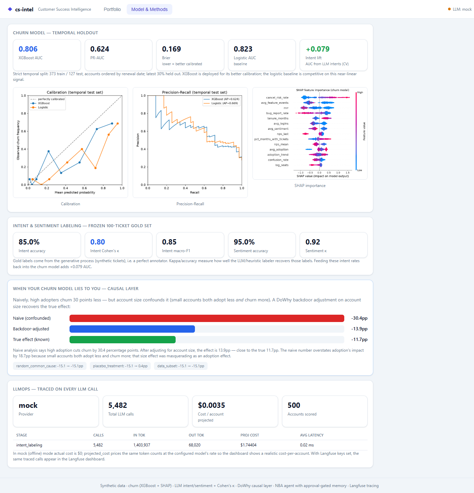
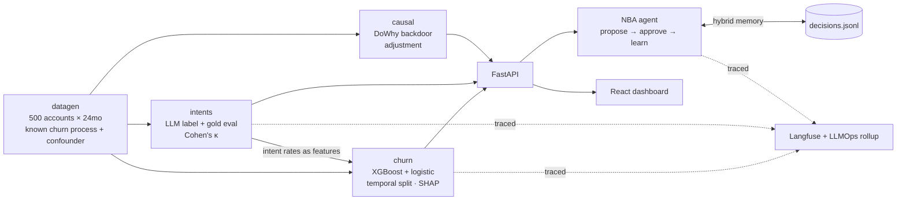

# cs-intel — Customer-Success Intelligence

An end-to-end customer-success intelligence stack on synthetic data:
**churn prediction** (classical ML), **ticket intent/sentiment** (LLM + rigorous eval),
a **causal-inference layer** most CS tooling never builds, and a **next-best-action agent**
that proposes interventions behind a **human-approval gate** with **memory that learns from
every operator decision**.

```
docker compose up --build     # then open http://localhost:5173
```

Click an account → see its churn risk with a SHAP explanation → read its intent-tagged
support tickets → let the agent propose a next-best-action → **approve or reject it** →
watch the approval update the agent's memory. Runs **fully offline with zero API keys**
(a deterministic mock LLM stands in), so the demo always works; add keys to exercise the
real LLM + Langfuse tracing paths.



_Model & Methods tab — churn metrics, the causal analysis, and LLMOps:_



---

## Why this exists

Predicting churn is table stakes. This project closes the three gaps that separate a
churn *score* from a customer-success *system*:

| Gap | What most stacks miss | What's here |
|-----|-----------------------|-------------|
| **2 — Supervised ML done right** | leakage, no calibration, no explanation | strict temporal split, AUC/PR-AUC/calibration/Brier, SHAP, a model card |
| **3 — Unstructured signal** | tickets sit unused | LLM intent + sentiment labeling, a **frozen 100-ticket gold set**, Cohen's κ, and the intent rates fed back into the churn model (**+0.08 AUC**) |
| **4 — LLMOps** | LLM calls are untraced and unbudgeted | Langfuse tracing on every call + a local cost/eval dashboard (**~$0.0035 / account scored**) |

Plus the two differentiators:

- **A causal layer** (`causal/`, DoWhy) — because a churn model's feature importance is
  *not* a causal to-do list. See **[When your churn model lies to you](#when-your-churn-model-lies-to-you)**.
- **An agent that learns from every interaction** — propose → human approval → memory
  write-back that measurably shifts the next proposal.

---

## Architecture



Repo layout:

```
cs-intel/
  datagen/    synthetic account/event/ticket generator (the known ground truth)
  churn/      XGBoost + logistic, temporal split, SHAP, calibration  (gap 2)
  intents/    LLM labeling + frozen gold eval + intent features       (gap 3)
  causal/     DoWhy confounding analysis + notebook                   (differentiator)
  agent/      next-best-action agent + hybrid learning memory         (product tie-in)
  api/        FastAPI service (repository + endpoints)
  ui/         minimal React dashboard (Vite + nginx)
  common/     config, paths, the traced LLM client, LLMOps rollup     (gap 4)
  scripts/    build_pipeline.py (datagen→intents→churn→causal→llmops)
  tests/      pytest suite (55 tests)
```

---

## Quickstart

### Docker (the whole stack)

```bash
docker compose up --build
# UI  → http://localhost:5173
# API → http://localhost:8000/api/health   (docs at /docs)
```

On first start the `api` container builds the dataset + trains the model + labels tickets
(~30s, deterministic), then serves. Artifacts and agent memory persist in named volumes,
so restarts are instant and learned decisions survive.

### Local (for development)

```bash
make setup              # python -m venv .venv && pip install -r requirements-dev.txt
make pipeline           # datagen → intents → churn → causal → llmops   (~30s)
make api                # FastAPI on :8000
make ui                 # Vite dev server on :5173  (proxies /api → :8000)
make test               # pytest (55 tests)
```

Each stage is also runnable on its own: `python -m datagen`, `python -m intents`,
`python -m churn.train`, `python -m causal`, `python -m common.llmops`.

### Using a real LLM + tracing (optional)

Copy `.env.example` → `.env`, set `CS_INTEL_LLM_PROVIDER=anthropic` and `ANTHROPIC_API_KEY`
(and/or Langfuse keys). Every labeling call, agent proposal, and eval then runs on the real
model and streams to Langfuse. With no key, the pipeline transparently falls back to the
deterministic heuristic — it never crashes mid-run for lack of a secret.

---

## 1 · Synthetic data — a *known* ground truth

`datagen/` generates **500 B2B accounts over 24 months**: usage events, seat counts, NPS,
renewal dates, and free-text support tickets. Two things are injected on purpose:

- **A known churn-generating process.** Churn is drawn from an explicit structural
  equation in `(account size, feature adoption, support friction, explicit
  dissatisfaction)`, so the true drivers — and the true causal effects — are *knowable*
  and checked against the models.
- **One deliberate confounder.** *Account size* drives **both** adoption (small accounts
  adopt less) **and** churn (small accounts churn more). That's what makes the naive
  adoption→churn estimate a lie — and what the causal layer untangles.

Ticket text is slot-filled from intent/sentiment templates, with ~18% deliberately
*ambiguous* (a cancel-risk ticket worded like a bug report) so the labeling eval isn't
trivially perfect.

Result: **30% churn base rate**, ~5,500 tickets, a frozen 100-ticket gold label set.

---

## 2 · Churn model (gap 2) — model card

**Task.** Predict whether an account churns at its contract renewal, using only signals
observed *before* renewal.

**Data & split.** One row per account (500). **Strict temporal split**: accounts are
ordered by renewal date and the latest 30% held out — training renewals all precede test
renewals in calendar time. Features are aggregated only over the 6 months *before* each
renewal, so nothing from the renewal month or later leaks in. Train 373 / test 127.

**Models.** Gradient-boosted trees (**XGBoost**, deployed) + a **logistic-regression
baseline**. Typed Python, tested, deterministic.

**Results (temporal holdout, test base rate 0.276):**

| Model | ROC-AUC | PR-AUC | Brier |
|-------|:------:|:------:|:-----:|
| **XGBoost** (deployed) | **0.806** | 0.624 | **0.169** |
| Logistic (baseline) | 0.823 | 0.669 | 0.206 |

The logistic baseline is genuinely competitive because the dominant signals are close to
monotonic — an honest outcome, not a bug. XGBoost is deployed for its markedly better
**calibration** (Brier 0.169 vs 0.206; see `artifacts/calibration_curve.png`) and its
ability to capture the friction×dissatisfaction interaction.

> _Figures are from the reference `docker compose up` run (the screenshots above).
> XGBoost/BLAS threading can shift them ~±0.01 across machines; the data is otherwise
> deterministic given the seed._

**Explainability.** Global + per-account **SHAP**. Top drivers: `cancel_risk_rate` (the
LLM-derived intent feature is the single most important predictor), `mrr`,
`bug_report_rate`, `avg_feature_events`, `avg_logins`, `tenure_months`. Every account in
the dashboard shows its own ranked SHAP contributions.

**Intended use / limits.** Trained on synthetic data for demonstration; the pipeline and
hygiene are the product, not the coefficients. Scores are decision *support* behind a human
gate, never automated action.

---

## 3 · Intent & sentiment (gap 3)

`intents/` labels every ticket into one of four intents — **cancel-risk, expansion-signal,
confusion, bug-report** — plus sentiment, via the traced LLM client (real model when a key
is set; a deterministic keyword heuristic otherwise).

**Evaluation on the frozen 100-ticket gold set** (same rigor vocabulary as an annotation
study — accuracy *and* chance-corrected agreement):

| Task | Accuracy | Cohen's κ | Macro-F1 |
|------|:-------:|:---------:|:--------:|
| Intent | 0.85 | **0.80** | 0.848 |
| Sentiment | 0.95 | 0.92 | 0.958 |

Because tickets are synthetic, the gold label is the generative intent — a perfect
annotator — so κ measures how well the labeler recovers it. (Swap in a real LLM and this
climbs; the heuristic is the floor.)

**Lift back into churn.** Per-account intent rates (cancel-risk rate, negative-sentiment
rate, …) are fed to the churn model as features. Measured by repeated 5-fold CV (a single
127-account holdout is too noisy for a few-point lift):

> **AUC 0.735 → 0.814 with intent features (+0.079).**

The mechanism is deliberate: a hidden "explicit dissatisfaction" driver is visible **only**
through the *intent* of tickets, not their volume or sentiment — so the LLM labels carry
signal the raw counts can't.

---

## When your churn model lies to you

*(The causal layer — `causal/analysis.py` + `causal/causal_analysis.ipynb`.)*

Ask the churn model "does feature adoption reduce churn?" and it answers with conviction:

> **Naive estimate: high-adoption accounts churn 30.4 percentage points less.**

Act on that and you'd pour the CS budget into adoption campaigns. But it's **confounded**:
small accounts both adopt less *and* churn more, so a big chunk of that "adoption effect"
is really an *account-size* effect wearing a disguise. Using **DoWhy** to identify the
backdoor path and adjust for account size:

| Estimate | Effect (risk difference) |
|----------|:------------------------:|
| Naive (confounded) | **−30.4 pp** |
| Backdoor-adjusted — logistic g-computation | **−13.9 pp** |
| Backdoor-adjusted — DoWhy linear regression | −15.1 pp |
| Backdoor-adjusted — propensity stratification | −15.5 pp |
| **True effect (known from the generator)** | **−11.7 pp** |

Adjusting for account size removes **~88% of the confounding bias** and lands next to the
true effect. Refutation checks behave as they should: a random common cause leaves the
estimate stable, and a **placebo treatment collapses it to ~0**.

The lesson — and why a CS-intelligence product needs a causal layer, not just a predictive
one: **a churn model's feature importance is a correlational readout, not an intervention
plan.** The full walkthrough (with plots and the DAG) is in
[`causal/causal_analysis.ipynb`](causal/causal_analysis.ipynb).

---

## 5 · Next-best-action agent (product tie-in)

`agent/` reads an at-risk account's state — churn risk, SHAP drivers, intent-tagged tickets
— and proposes **one** intervention: an escalation, an outreach email draft, a
success-manager task, or expansion outreach. Then it **stops**.

**Propose → approve → learn.** Nothing executes. A human approves or rejects in the
dashboard, and the decision is written back to a **hybrid memory** (`agent/memory.py`):

- **Structured policy** — Laplace-smoothed approval rates per (action type, risk tier).
  This is the learning substrate: reject "escalation" for medium-risk accounts a few times
  and the agent visibly stops leading with it.
- **Semantic recall** — a deterministic local embedding retrieves the most similar past
  decisions to ground each new proposal (no API key needed).

So the system "learns from every interaction" — and you can watch the approval-rate bars
move in the UI as you decide. Every proposal is a traced LLM call.

---

## 6 · LLMOps (gap 4)

`common/llm.py` wraps every LLM call (labeling, agent proposals, evals) with:

- **Langfuse tracing** when keys are present — traces, token usage, and cost per call.
- **A local rollup** (`common/llmops.py` → `artifacts/llmops_summary.json`) that mirrors it
  offline: per-stage calls/tokens/latency, **cost per account scored**, and an
  **eval-scores-over-time** history appended on every pipeline run.

Current run: **5,482 traced calls**, projected **$0.0035 / account scored** (mock mode
prices the same token counts at the configured model's rate so the number is meaningful
offline). The **Model & Methods** tab in the dashboard surfaces all of it; the identical
traces appear in Langfuse once keys are set.

---

## Design note: it runs with no secrets

The whole pipeline is built so `docker compose up` produces a complete, reproducible
dashboard with **zero configuration**. Every LLM-backed stage takes a deterministic `mock`
callable used whenever no provider key is configured, and `Settings.effective_provider`
downgrades to `mock` automatically rather than failing mid-run. Set a key and the same code
paths call the real model and trace to Langfuse.

---

## Quality

- **Typed Python** throughout; `ruff` + `mypy` configured in `pyproject.toml`.
- **55 pytest tests** (`make test`): datagen determinism, temporal-split leakage guards,
  labeler validity + κ bounds, causal recovery (adjustment shrinks the effect toward the
  truth), memory learning, and the API repository.
- Deterministic given the seed; artifacts regenerate identically.

```bash
make test        # 55 passed
make lint        # ruff
make typecheck   # mypy
```

---

## Acceptance checklist (DONE WHEN)

- [x] `docker compose up` → a dashboard
- [x] click an account → churn risk with SHAP explanation
- [x] read intent-tagged tickets
- [x] approve/reject an agent-proposed action
- [x] the approval visibly updates memory

---

_Synthetic data · no real customer information. Built as a working demonstration of a
customer-success intelligence pipeline._
